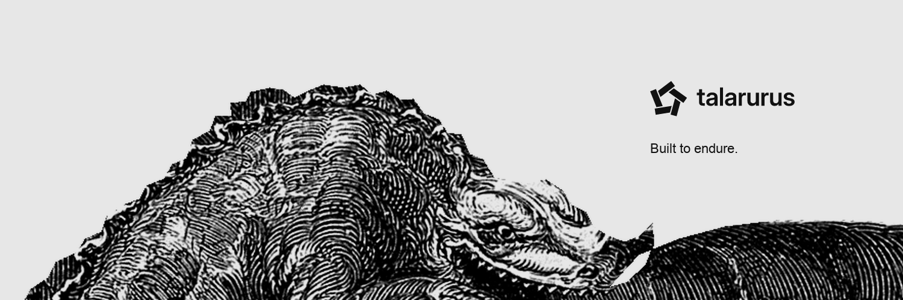

# Independent software. Built to endure.

Talarurus is an independent studio building security, developer, and local-first software. Focused tools for understanding software and keeping control of your data.

[talarurus.com](https://talarurus.com/) · [Contact](https://talarurus.com/contact/)

## Hammerhead

**Repository auditing, on your machine.**

A local-first command-line tool that inspects source repositories without running their build scripts or package managers. It checks supported credential patterns, sensitive filenames, and repository hygiene, with readable terminal reports and structured JSON.

**Status:** Historical v0.1.0 release; active development on [`v0.2-dev`](https://github.com/talarurus/hammerhead/tree/v0.2-dev). v0.2 is not released.

[Explore Hammerhead](https://github.com/talarurus/hammerhead) · [Product and documentation](https://talarurus.com/hammerhead/)

## plainbalance

**Personal finance, kept local.**

Local-first finance software for accounts, spending, cash flow, budgets, and net worth, without a cloud account requirement.

**Status: v0.3.1 Developer Preview.** Public source for development with fictional data; no verified consumer-ready download. Databases and exported backups are currently unencrypted.

[Explore plainbalance](https://github.com/talarurus/plainbalance)

## Built with care

Local control, clear outputs, and portable data guide the work. Talarurus favors focused tools, documented limits, and a clear distinction between released software and work in development.

---

[Website](https://talarurus.com/) · [Contact](https://talarurus.com/contact/) · [Security reporting](https://talarurus.com/security/)

Historical engraving: E. Ferington after Édouard Riou, 1863. [Wellcome Collection](https://wellcomecollection.org/works/z7auazav), 42517i / V0023197.
